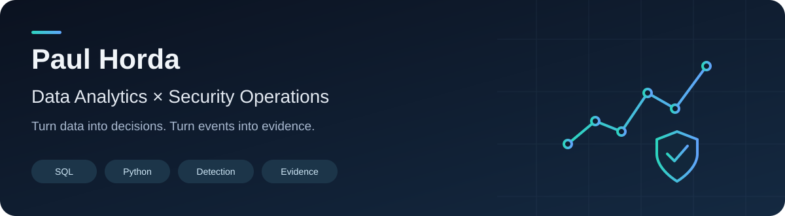

I’m building a portfolio at the intersection of **data analysis and defensive security**, with a foundation in **Kotlin and Android development**.

My focus: clear metrics, reproducible investigations and conclusions backed by evidence.

### Featured projects

| Data Analytics | Security Operations |
|---|---|
| **[Retail Analytics Lab](https://github.com/paulhorda/retail-analytics-lab)** | **[SOC Alert Triage Lab](https://github.com/paulhorda/soc-alert-triage-lab)** |
| SQL and Python analysis of conversion, revenue, refunds and customer cohorts. | Python detection rules for authentication events, with evidence timelines and incident triage. |
| 6 related tables · 9,300 synthetic visits · 5 SQL analyses | 1,231 synthetic events · 3 detection rules · documented false positives and blind spots |
| [Dashboard and findings](https://github.com/paulhorda/retail-analytics-lab/blob/main/reports/findings.md) · [SQL](https://github.com/paulhorda/retail-analytics-lab/tree/main/sql) | [Triage report](https://github.com/paulhorda/soc-alert-triage-lab/blob/main/reports/triage-report.md) · [Investigation walkthrough](https://github.com/paulhorda/soc-alert-triage-lab/blob/main/docs/incident-walkthrough.md) |

Both projects are reproducible portfolio labs using explicitly synthetic data. Each includes source code, tests, generated outputs and limitations.

### Areas of focus

**Data:** SQL joins, CTEs and window functions; Python; SQLite; metric definitions; data quality; cohorts; visual reporting.

**Security:** authentication logs; detection logic; event correlation; alert triage; investigation notes; MITRE ATT&CK mapping.

**Engineering foundation:** Kotlin; Android; Room/SQLite; REST APIs; coroutines and Flow; Git.

### Earlier engineering work

- **[Repair Calculator](https://github.com/paulhorda/RepairCalculator)** — renovation planning, relational local storage and chart-based statistics. Public checkout has a documented missing drawing-module dependency.
- **[Android Video Player](https://github.com/paulhorda/PlayerNitrixTest)** — API integration, local metadata caching and Media3 playback.

Learning through projects. Publishing the method, the evidence and the limits alongside the result.
